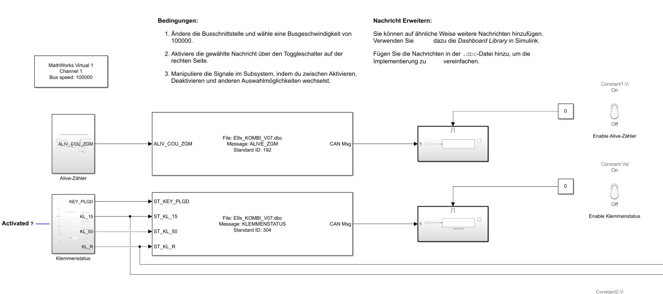

# Instrument Cluster: CAN Bus Control

A MATLAB/Simulink model and a DBC file that drive a real BMW E9x instrument cluster over CAN.

We built this as a team in the master's course *Embedded Systems and Networking of Mechatronic Systems* at Frankfurt UAS (winter semester 2024/25). The project is finished.

My part was the signal side: I wrote the DBC file, built the Simulink CAN model and checked the signals on the real cluster with the CAN Explorer.

| Instrument cluster | Simulink model |
|---|---|
|  |  |

*Left: illustration of a BMW E9x instrument cluster (stock image, not a photo of the project setup). Right: excerpt of the Simulink model.*

## What it does

The model sends CAN messages to the cluster, so the needles and lamps react. Every signal is set by hand from a Simulink dashboard with sliders, switches, combo boxes and gauges. On the real cluster, engine speed, vehicle speed, the turn signals and the ignition terminals were displayed correctly.

The signals are described in one DBC file (`PKW/bmw-e9x-can-database.dbc`) with 14 messages for the cluster (Kombi): vehicle speed, engine speed, indicator and warning lamps, ignition terminals, transmission display, seat belts, time and date, and the raw fuel tank sensor values. New signals can be added to the DBC file and to the model without changing its structure.

## Requirements

- MATLAB, Simulink and Vehicle Network Toolbox (R2024b)
- A CAN interface that the Vehicle Network Toolbox supports (for example Peak PCAN, IXXAT or Vector) to drive the real cluster. Without hardware, the model can be tested with a virtual CAN channel.

## Getting started

1. Open the project `PKW/simulation.prj` in MATLAB.
2. Open the model `can-signal-sim.slx`.
3. Select your CAN device in the CAN Configuration block. The model is saved with the MathWorks virtual channel. If MATLAB reports a missing DBC file, point the CAN Pack blocks to `PKW/bmw-e9x-can-database.dbc`.
4. Run the model (Ctrl+T).

## License

Copyright (c) 2026 Mutasem Bader. All rights reserved.
Viewing is permitted. Copying, modifying, or submitting as own work is strictly prohibited.
See [LICENSE](LICENSE) for details.
