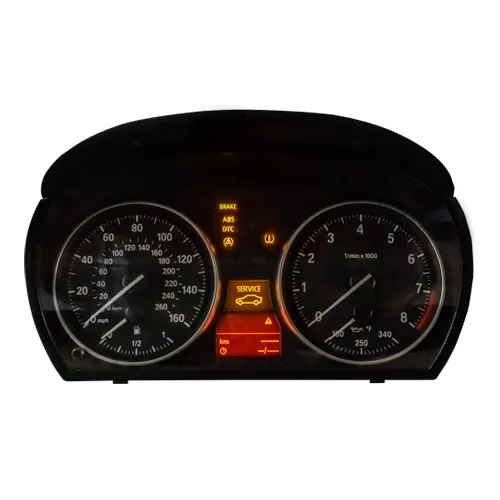

# Instrument Cluster: CAN Bus Control

A MATLAB/Simulink model and a DBC file that drive a real BMW E9x instrument cluster over CAN.

We built this as a team in the master's course *Embedded Systems and Networking of Mechatronic Systems* at Frankfurt UAS (winter semester 2024/25). The project is finished.

My part was the signal side: I wrote the DBC file, built the Simulink CAN model and checked the signals on the real cluster with the CAN Explorer.

| Instrument cluster | Simulink model |
|---|---|
|  |  |

*Left: illustration of a BMW E9x instrument cluster (stock image, not a photo of the project setup). Right: excerpt of the Simulink model.*

## What it does

- Sends real CAN messages to the cluster, so the needles and lamps react
- Describes the cluster signals in one `.dbc` file with 14 messages
- Lets you set every signal by hand from a Simulink dashboard with sliders, switches, combo boxes and gauges
- New signals can be added in the DBC file and in the model without changing the structure

On the real cluster, engine speed, vehicle speed, the turn signals and the ignition terminals were displayed correctly.

## System Architecture

```
┌─────────────────────────────┐
│  Simulink dashboard         │  (can-signal-sim.slx)
│  - Sliders, switches,       │
│    combo boxes, gauges      │
│  - Signal values set by hand│
└──────────────┬──────────────┘
               │ Simulink CAN Pack / CAN Transmit blocks
               ▼
┌──────────────────────────────┐
│  Vehicle Network Toolbox     │  CAN channel (virtual or hardware)
│  CAN channel (Peak/IXXAT/…)  │
└──────────────┬───────────────┘
               │ Physical / virtual CAN bus
               ▼
┌──────────────────────────────┐
│  BMW E9x Instrument Cluster  │  (real hardware)
└──────────────────────────────┘
```

## Technical Overview

| Layer | Technology |
|---|---|
| Signal definition | DBC file (`bmw-e9x-can-database.dbc`) |
| Signal model | MATLAB/Simulink (`can-signal-sim.slx`) |
| CAN transmission | MATLAB Vehicle Network Toolbox |
| Project management | MATLAB Project (`simulation.prj`) |

### DBC File

The `bmw-e9x-can-database.dbc` file defines 14 CAN messages and their signals for the BMW KOMBI (Kombiinstrument). Key signals include vehicle speed, engine speed, indicator and warning lamps, terminal status (ignition), transmission display, seat-belt state, time and date, and raw fuel-tank sensor data.

## Requirements

| Tool | Version |
|---|---|
| MATLAB | R2024b |
| Simulink | R2024b |
| Vehicle Network Toolbox | R2024b |
| CAN interface | Any interface supported by the Vehicle Network Toolbox (e.g. Peak PCAN, IXXAT, Vector) |

For the real cluster a CAN interface is required; a virtual CAN channel can be used to test the model without hardware.

## Getting Started

1. Open MATLAB R2024b.
2. Open the project file: `PKW/simulation.prj`
3. Open the Simulink model: `can-signal-sim.slx`
4. Configure the CAN channel in the **CAN Configuration** block. The model is saved with the MathWorks virtual CAN channel; select your CAN device to drive a real cluster. If MATLAB reports a missing DBC file, point the **CAN Pack** blocks to `PKW/bmw-e9x-can-database.dbc`.
5. Run the model (`Ctrl+T`).

## Project Structure

```
Instrument-Cluster/
├── images/
│   ├── instrument-cluster-hardware.png     Illustration of the cluster (not the project setup)
│   └── instrument-cluster-simulation.png   Simulink model screenshot
├── PKW/
│   ├── bmw-e9x-can-database.dbc            CAN signal database
│   ├── simulation.prj                      MATLAB project file
│   └── can-signal-sim.slx                  Simulink model
└── README.md
```

## License

Copyright (c) 2026 Mutasem Bader. All rights reserved.  
Viewing is permitted. Copying, modifying, or submitting as own work is strictly prohibited.  
See [LICENSE](LICENSE) for details.
